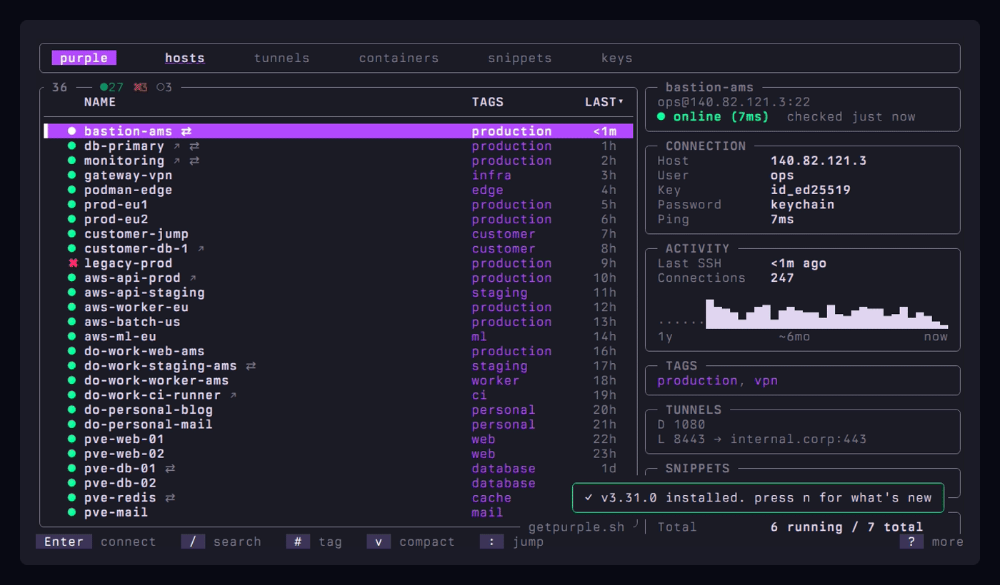

<p align="center">
  
</p>

<p align="center"><b>Your ssh config, synced with your cloud.</b></p>

<p align="center">
  <a href="https://crates.io/crates/purple-ssh"></a>
  <a href="https://crates.io/crates/purple-ssh"></a>
  <a href="https://github.com/erickochen/purple/stargazers"></a>
  <a href="LICENSE"></a>
  <a href="https://ratatui.rs/"></a>
  <a href="https://getpurple.sh"></a>
</p>

**purple is a free, open-source terminal SSH manager and SSH config editor in Rust for macOS and Linux that keeps `~/.ssh/config` in sync with 18 cloud providers, monitors live SSH tunnels and manages Docker and Podman containers fleet-wide.**

Spin up a VM on AWS, GCP, Azure, Hetzner, Proxmox or 13 other cloud providers and it's in your host list before the console catches up. Kill one and purple marks it stale, so your list never lies. No more hand-editing `~/.ssh/config` after every Terraform run, no more digging through cloud consoles for the right IP.

Everything else you do over SSH lives in the same terminal: fuzzy search across hundreds of hosts, visual file transfer, multi-host SSH key push, short-lived HashiCorp Vault SSH certificates and an MCP server for AI agents. Keyboard-driven. Single binary. MIT licensed.



## Install

```
curl -fsSL getpurple.sh | sh
```

<details>
<summary>specific version, brew, cargo, nix, AUR or from source</summary>

Pin a specific version with `PURPLE_VERSION`:
```
curl -fsSL getpurple.sh | PURPLE_VERSION=1.2.3 sh
```
```
brew install erickochen/purple/purple
```
```
cargo install purple-ssh
```
```
nix profile install github:erickochen/purple
```
```
paru -S purple-bin
```
```
yay -S purple-bin
```
```
git clone https://github.com/erickochen/purple.git
cd purple && cargo build --release
```
</details>

Claude Desktop users can install the [.mcpb bundle](https://github.com/erickochen/purple/releases/latest) for one-click MCP integration (read-only by default). Setup details on the [MCP Server wiki](https://github.com/erickochen/purple/wiki/MCP-Server). No data leaves your machine. See [PRIVACY.md](PRIVACY.md).

Run `purple`. Press `?` on any screen for help. That's it.

## Contents

- [Why I built this](#why-i-built-this)
- [What you get](#what-you-get)
- [How purple compares](#how-purple-compares)
- [How it works](#how-it-works)
- [Links](#links)

## Why I built this

My SSH config was fine. Proper aliases, ProxyJump chains, organized by provider. Not the problem.

The problem was everything around it. Need to check a container? `ssh host docker ps`. Copy a file? `scp` with the right flags. Run the same command on ten hosts? Write a loop or boot up Ansible for a one-liner. Spin up a VM on Hetzner? Open the console, grab the IP, edit config, save. Someone asks which box runs what? Good luck.

I wanted one place for all of that. So I built it.

## What you get

### Your ssh config tracks your infra

Drop in one API token per provider. New machines land in `~/.ssh/config` the moment they boot, IPs follow instances as they move and decommissioned hosts gray out instead of lingering. 18 providers including AWS, GCP, Azure, Hetzner, DigitalOcean, Proxmox, Teleport and NetBox, multiple accounts each. On AWS that means a role per account and, with Session Manager on, even the instances with no public address. See the [wiki](https://github.com/erickochen/purple/wiki/Cloud-Providers) for the full list.


One panel answers the questions you actually have. Is it up. How do I reach it. When was I last on it. What runs there. Connection info, jump route, a year of SSH activity, tags, tunnels and containers per host, with live health dots.


### Jump to anything with one keystroke

Press `:` and type four letters. Any host, tunnel, container, snippet or action, ranked by how often you use it. It searches the SSH `User`, `ProxyJump` and Vault SSH role too, so typing your username finds every server you log in as. Field prefixes (`user:`, `proxy:`, `vault:`, `tag:`) cut straight to one directive. Like Linear's `Cmd+K`, but in your terminal.


### Manage Docker and Podman on every server, over SSH

Your whole fleet's containers in one list, grouped per host. Shell in, stream logs, restart, stop, exec or kick a whole compose stack member by member. No agent on the remote, no web UI, no extra ports. Just SSH.


### Monitor SSH tunnels in real time

Forwards run blind. purple doesn't: every Local, Remote and Dynamic SOCKS forward with live throughput, channel activity and uptime, down to the exact app behind each connection.


### Run one command across your fleet

Save a command once, run it on any set of hosts. purple shows the blast radius before you fan out and keeps the track record per snippet. "28 of 29 host runs ok" is a number you want to see before production.


### Push any SSH key to your fleet, no ssh-copy-id loop

Every key in `~/.ssh`, scored and fingerprinted, with the hosts it unlocks and the last time it was used. Push one to your whole fleet with `p`. Vault-managed hosts skip automatically, so cert-managed stays cert-managed.


Short-lived certificates from the HashiCorp Vault SSH secrets engine get a TTL strip of their own, so an expiring cert never surprises you.


### And more

- Visual file transfer with a split-pane local and remote explorer.
- Automatic password retrieval from OS Keychain, 1Password, Bitwarden, pass, the HashiCorp Vault KV secrets engine and Proton Pass.
- Short-lived SSH certificates signed via the HashiCorp Vault SSH secrets engine.
- MCP server for AI agents like Claude Code and Cursor, with a read-only mode and a JSON Lines audit log.
- Your own ssh wrapper for interactive logins, such as kitty's `kitten ssh`, via one preference or `PURPLE_SSH_COMMAND`.
- XDG Base Directory support: set `XDG_CONFIG_HOME` and friends (or `PURPLE_CONFIG_DIR` and friends) and purple splits its files into config, data, state and cache. Unset, everything stays in `~/.purple`.

See the [wiki](https://github.com/erickochen/purple/wiki) for details.

## How purple compares

| | purple | Termius | sshs | Lazydocker |
|---|---|---|---|---|
| Open source | Yes (MIT) | No | Yes | Yes |
| Language | Rust | Electron | Rust | Go |
| Multi-cloud SSH sync | 18 providers | Limited | No | No |
| Containers over SSH | Docker and Podman, fleet-wide | No | No | Local host only |
| Live tunnel monitoring | Yes | No | No | No |
| MCP server for AI agents | Yes | No | No | No |
| Account required | No | Yes | No | No |
| Price | Free | Freemium | Free | Free |

purple keeps your SSH config local and editable: it edits `~/.ssh/config` in place with round-trip fidelity. Use Lazydocker for single-host local Docker, purple for fleet-wide remote management.

## How it works

purple reads `~/.ssh/config` directly. No database, no daemon, no account. Comments, indentation, include files, unknown directives: all preserved through every edit, so the config you wrote stays the config you have.

Written in Rust. Single binary. 6700+ tests. MIT license.

## Links

[Wiki](https://github.com/erickochen/purple/wiki) · [Cloud Providers](https://github.com/erickochen/purple/wiki/Cloud-Providers) · [MCP Server](https://github.com/erickochen/purple/wiki/MCP-Server) · [FAQ](https://github.com/erickochen/purple/wiki/FAQ) · [Troubleshooting](https://github.com/erickochen/purple/wiki/Troubleshooting) · [Security](SECURITY.md) · [llms.txt](https://getpurple.sh/llms.txt)

## Sponsors

purple is free and open source. These people chip in to keep it that way. Thank you!

<a href="https://github.com/alex2chivas"></a>

[Alexis Flores](https://github.com/alex2chivas)

Want to join them? [Sponsor purple on GitHub](https://github.com/sponsors/erickochen).

## Credits

Screenshots and the demo are generated from the live TUI in [Berkeley Mono](https://usgraphics.com/products/berkeley-mono) by [U.S. Graphics Company](https://usgraphics.com/), recorded with [VHS](https://github.com/charmbracelet/vhs). They regenerate whenever the UI changes on master, so what you see here always matches the current build.

## Feedback

Bug or feature request? [Open an issue](https://github.com/erickochen/purple/issues).
